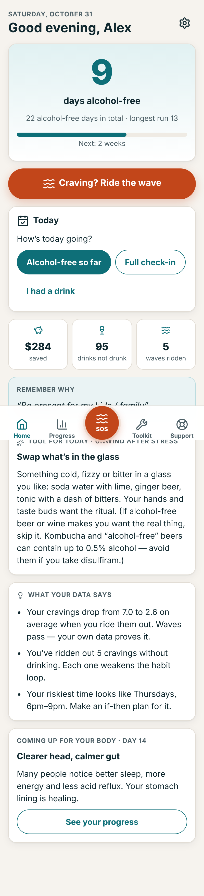
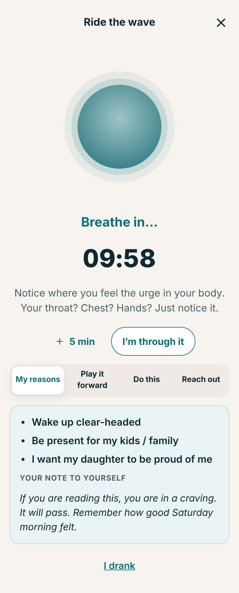
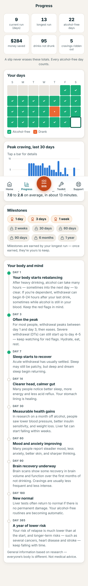

# Tidewise 🌊

**Cravings are waves. Learn to ride them.**

Tidewise is a private, evidence-based companion app with one purpose: helping a person who
drinks **stop drinking alcohol — safely, and for good.** It's built around how stopping actually
feels from the inside: alcohol does real *jobs* for people, cravings feel endless, slips trigger
shame spirals, withdrawal can be dangerous, and asking for help is hard.

It is an installable Progressive Web App (iPhone, Android, desktop). It works offline, needs no
account, and never sends data off the device.

| Home | Ride the wave (SOS) | Progress |
|---|---|---|
|  |  |  |

---

## What makes it different

| The drinker's reality | What Tidewise does |
|---|---|
| *"It's the only thing that switches me off / gets me to sleep / gets me through a party."* | **"What does drinking do for you?"** — 13 drinking jobs (stress, anxiety, sleep, numbing pain, low mood, social confidence, fitting in, boredom, loneliness, reward, habit, withdrawal, physical pain). Each gets an honest explanation of what alcohol really does long-term, plus **replacement tools matched to that job**. These shape the whole app. |
| *"When the craving hits it feels like it'll never stop."* | One-tap **SOS: Ride the wave**: rate the urge → breathing-paced wave timer with urge-surfing prompts → *my reasons* / *play it forward* / *do this instead* / *reach out* → re-rate. It then shows the person **proof from their own data** that waves pass ("your cravings drop from 7.0 to 2.6 on average"). |
| *"I slipped on day 40, the counter hit zero, so I drank for a week."* | **A slip never erases progress.** Total alcohol-free days, longest run, money saved and milestones survive. A compassionate **slip flow** turns the slip into an if-then plan. |
| *"I get the shakes in the morning. I'm scared to stop."* | A **withdrawal-safety screen** (NICE-aligned) steers dependent drinkers to medically supported withdrawal. A **withdrawal monitor** triages symptoms: self-care / call for medical advice today / emergency now. |
| *"I didn't know there were pills for this."* | Only ~2.5% of people with alcohol use disorder get medication. A plain-language medicines lesson plus a **doctor-visit prep sheet** that writes the hard conversation for you. |
| *"I'm not an 'alcoholic'."* | No labels, no feed, no account. A neutral name and icon, optional PIN lock, and data that stays on the device. |

## Features

- **Onboarding (~4 min):** what drinking does for you → the honest deal → usual drinking (standard-drink counter with regional measures) → WHO **AUDIT** → **withdrawal-safety screen** → choose a path (*stop on a set day*, *stop with medical support*, *step down to zero*) → reasons and a note to your future self → support person.
- **Home:** day counter, total alcohol-free days, money saved, drinks not drunk, waves ridden, next milestone, step-down limit for today (with **"hold this step"**), prep checklist before your quit day, withdrawal check prompts, a tool of the day matched to *your* drinking jobs, and personal insights (riskiest weekday and time, top trigger, sleep vs craving).
- **SOS: Ride the wave:** a 5–20 minute guided urge-surf. A "Shaky / unwell" trigger routes to the withdrawal check.
- **Daily check-in:** drank? · mood · peak craving · sleep · HALT (Hungry, Angry, Lonely, Tired). An "Awful" mood surfaces the crisis line.
- **Slip flow:** compassion → safety (lowered tolerance, withdrawal) → what happened → what next time → saved as an if-then plan.
- **Progress:** current and longest run, totals, calendar, 30-day craving chart (accessible table fallback), urge-drop stats, milestones, a hedged body-and-mind timeline.
- **Toolkit:** tools for your *why* · thinking traps and reframes (plus your own thought records) · if-then plans · saying-no scripts · breathing · 5-4-3-2-1 grounding · HALT · decisional balance · 10 evidence-based lessons · withdrawal monitor.
- **Support:** emergency number · crisis line · regional helplines (US, UK, Ireland, Canada, Australia, NZ, India, other countries with a custom emergency number) · my people (one-tap call or pre-written text) · first-aid guidance for supporters · peer-support groups · doctor-visit prep (copy, share, print).
- **Privacy:** no network calls (enforced by a test), salted-hash PIN lock that re-locks after a minute in the background, JSON export and restore, delete everything. If the browser blocks storage, the app still works and says plainly that nothing will be saved.

The full product and clinical specification is in **[docs/PRODUCT_SPEC.md](docs/PRODUCT_SPEC.md)**.

## Clinical safety model (summary)

- **High risk** (e.g. past seizures/DTs; daily drinking with relief or morning drinking; daily ≥120 g; daily + AUDIT ≥20; sedatives, a serious condition or pregnancy with regular drinking) → "Please don't stop suddenly on your own." Defaults to the medical path. Stopping or stepping down alone requires confirming that a doctor is involved.
- **Moderate risk** → "Talk to a doctor before you stop", with the region's same-day medical line (NHS 111, 811, healthdirect, Healthline, and so on). Withdrawal monitoring is prompted.
- **Withdrawal triage** escalates on red flags (including Wernicke's signs, GI bleeding and head injury), for high-risk users, for tremor with sweating, and when symptoms are worsening. Suicidal thoughts always show the crisis line, even alongside a medical emergency.
- **Step-down** uses a shrinking *weekly* budget, so binge drinkers are never pushed into daily drinking. It runs at least 21 days for dependent drinkers, and "hold this step" lets the plan pause.

An independent clinical-safety review was run on the content and logic. All critical and high findings were fixed, and each fix is covered by tests. Helpline numbers were verified in October 2026.

> ⚠️ Tidewise is a self-help tool, not a medical device. It does not diagnose and does not replace professional care. Before a commercial launch it needs a review by a licensed addiction-medicine clinician, a usability study, and regulatory and privacy review (for example FDA/MHRA software-as-a-medical-device scope, GDPR/HIPAA as applicable).

## Run it

Requires Node 20+.

```bash
npm install
```

```bash
npm run dev
```

```bash
npm run build
```

```bash
npm run preview
```

`npm run build` type-checks, builds to `dist/`, and injects the offline precache list into `dist/sw.js`. `npm run preview` serves the build at http://localhost:4173.

### Deploy

`dist/` is a static site: upload it to any HTTPS host (Netlify, Vercel, Cloudflare Pages, GitHub Pages, S3 with CloudFront). HTTPS is required for offline mode and "Add to Home Screen". Asset paths are relative, so it also works from a sub-folder.

### Install on a phone

Open the deployed URL. On **iPhone**: Share → *Add to Home Screen*. On **Android (Chrome)**: menu → *Install app*. A long press on the icon gives an **SOS** shortcut on Android.

### App Store and Play Store

Wrap `dist/` with [Capacitor](https://capacitorjs.com) (`npx cap init`, `npx cap add ios`, `npx cap add android`) to ship native builds. Native wrappers also unlock the roadmap items: scheduled reminders before personal high-risk times, and a biometric lock.

## Tests

```bash
npm test
```

```bash
npm run test:e2e
```

- **55 unit tests** (Vitest) cover dates (DST, leap years), AUDIT scoring and bands, every withdrawal-risk rule, triage escalation, streaks and totals (slips never erase progress), money and drinks maths, the weekly-budget step-down and "hold this step", the withdrawal watch, insights, storage (corrupt data is preserved), backup import validation, PIN hashing, standard drinks, and the doctor report.
- **43 end-to-end tests** (Playwright, Pixel 7 emulation) cover every flow: onboarding (low and high risk, gating, AUDIT, drink counter, prep, step-down); SOS (timer completes under a fake clock, re-rate, ride another wave, "I drank", withdrawal routing); check-ins and slips (stats, if-then plan creation, crisis prompt, heavy-pattern warning, hold step); toolkit; all 10 lessons; support and region switching; doctor report and copy; withdrawal triage (emergency, crisis plus emergency, urgent with the regional medical line, self-care); PIN lock; export → delete → restore; theme; custom emergency number. Also: **offline** (the server is shut down mid-test and the app still loads), **no requests to other origins**, **storage-blocked mode**, and **axe WCAG 2.1 AA scans of 17 screens in light and dark** (zero serious or critical violations).

The whole E2E suite was run twice in a row with no flaky tests.

## Project structure

```
src/
  lib/          pure logic: safety.ts, audit.ts, stats.ts, insights.ts, storage.ts, doctorReport.ts, …
  content/      clinical copy: motives, lessons, thinking traps, scripts, timeline, regional helplines
  components/   UI kit, clinical forms, accessible charts
  screens/      Onboarding, Home, Sos, CheckIn, Slip, Progress, Tools, Support (+ Learn, Doctor, Withdrawal), Settings
  state/        store (localStorage with in-memory fallback)
public/         manifest, service worker, icons
scripts/        precache injection, icon rasteriser, screenshot generator
tests/          unit/ (Vitest) · e2e/ (Playwright) · fixtures/
docs/           PRODUCT_SPEC.md, screenshots/
```

## Roadmap

A validated self-rated withdrawal scale (SAWS) · native wrappers with scheduled reminders before personal high-risk times · biometric lock · end-to-end-encrypted sync · audio-guided urge surfing · wearable stress prompts · a clinician share portal (with consent) · localisation (Hindi, Spanish, French first) · clinical advisory board review and a formal evaluation.
